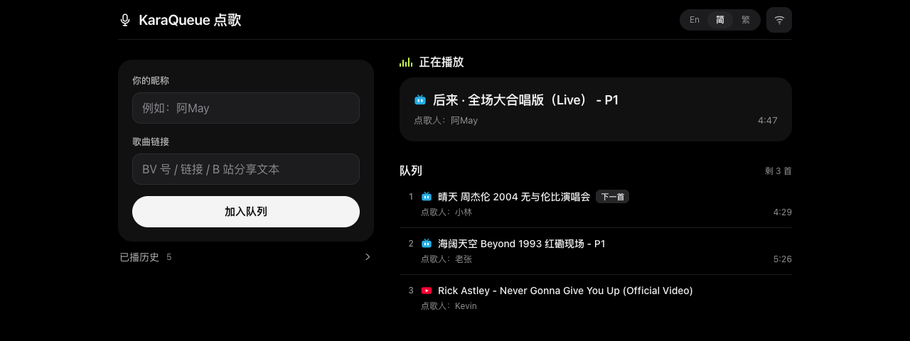
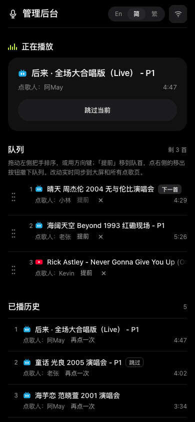
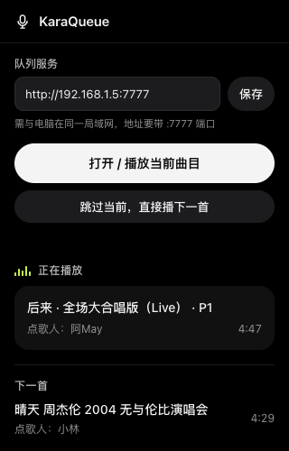

# KaraQueue

> [English](README.md) · [简体中文](README_zh-sc.md)

[](https://github.com/GarytheNoob/karaqueue/releases/latest)
[](https://github.com/GarytheNoob/karaqueue/releases/latest)
[](LICENSE)


<p align="center">
  
</p>

A LAN karaoke queue machine. Guests submit bilibili or YouTube videos from their phones, a queue server keeps the running order, and a browser extension drives the big-screen browser to play the next requested track automatically. The server uses only Node built-ins and has no npm dependencies.

## Introduction

<div align="center">

|  |  |
|:---:|:---:|
| admin console | extension popup |

</div>

**What it does, in short:**

- **Phone-first submitting.** The form accepts BV ids, av ids, full watch URLs, multi-part `?p=N` links and `b23.tv` short links; YouTube `watch?v=`, `youtu.be` and shorts links; and raw share text copied from either mobile app. Each part (P) of a multi-part bilibili video counts as one track. Playlists never expand; a YouTube link with `list=` queues that single video.
- **Instant playback.** A submission while the room is idle starts playing immediately and every client follows. A queued track plays next when the current one ends — the extension does the switching, so the session needs no clicks after the first one.
- **Host controls.** Skip, delete, reorder (drag, to-front button, or arrow keys), and re-request any played track — from the admin console or the extension popup.
- **Two room rules.** Allow the same track in the queue more than once; fair rotation, one song per guest.
- **Withdraw and history.** Guests can withdraw their own requests anytime; played tracks stay in a history where one tap puts a song back in the queue.
- **Real-time, sized for phones.** Every change rides on SSE, around 20 ms. Mobile browsers freeze background tabs and drop SSE connections, so each page re-syncs on refocus and polls every 5 seconds while visible.
- **Fully offline LAN stack.** Server, both pages and the extension are vanilla JS with zero dependencies; no CDN assets or fonts, everything ships in this repository.
- **Three interface languages** (English / Simplified / Traditional) with a header switcher; server-generated messages follow the chosen page language.
- **Chromium and Firefox.** One Manifest V3 extension for both: Chromium runs the background as a service worker, Firefox as an event page.

About metadata: bilibili throttles its metadata API under load (often HTTP 412), but a submission still succeeds — the server keeps a 24-hour cache, then falls back to parsing the video page's `window.__INITIAL_STATE__`, and only an invalid video id (codes -400/-404) is rejected. YouTube metadata comes from the official keyless oEmbed endpoint (title, author, thumbnail; no duration). When nothing can be fetched — deleted or region-locked videos, or a network that cannot reach either service — the track queues link-only and still plays, marked "metadata missing".

## Build and Install

**Requirements:** Node ≥ 18 (for the built-in fetch). Fetching YouTube metadata may also need a proxy, see [Troubleshooting](#errors-and-troubleshooting).

### Server

```sh
git clone https://github.com/GarytheNoob/karaqueue.git
cd karaqueue
node server/karaoke.mjs            # listens on 0.0.0.0:7777, admin on 0.0.0.0:7778
```

Devices on the LAN use `http://<machine-LAN-IP>:7777` (on macOS, `ipconfig getifaddr en0` prints the address). Environment variables:

| Variable | Meaning |
|---|---|
| `PORT` / `HOST` | page server port (default 7777) / bind address |
| `ADMIN_PORT` | admin console port, default 7778 |
| `KARAQUEUE_VIEW_API` / `KARAQUEUE_SPI_API` | override the bilibili endpoints (testing); `KARAQUEUE_OEMBED_API` overrides the YouTube one |
| `KARAQUEUE_PROXY` | force a proxy for cross-network requests, `host:port` or `http://host:port`. Unset: reads `HTTPS_PROXY`, then the macOS system proxy. Public hosts only; localhost, LAN and bilibili always connect direct |

### Browser extension

**Chromium (Chrome/Edge):**

1. Grab the extension zip from the [latest release](https://github.com/GarytheNoob/karaqueue/releases/latest) (or use this repository's `extension/` directory) and unzip it.
2. Open `chrome://extensions`, enable Developer mode, choose **Load unpacked** and select the unzipped folder.
3. Click the KaraQueue toolbar icon and confirm the server address. It defaults to `http://127.0.0.1:7777`; when the server runs on another machine, enter its LAN address and save.

**Firefox:**

1. Grab the same zip, then either
   - `about:debugging` → This Firefox → **Load Temporary Add-on** and pick the zip (temporarily installed; it will be gone after a restart), or
   - `npx web-ext run --source-dir extension/` for development with auto-reload, or
   - for a persistent install, use Firefox Nightly / Developer Edition, set `xpinstall.signatures.required` to `false` in `about:config`, and install the zip via the Add-on Manager's "Install Add-on From File".
2. Firefox grants site access at install time. If access is ever missing, saving the server address in the popup asks for it again, or grant it manually in the Add-on Manager's Permissions tab.

Guests never install anything: phones just open `http://<machine-LAN-IP>:7777`.

## Usage

### Quick start

1. Start the queue server on the big-screen machine.
2. On the big screen, open the first video — by hand or through the popup's "open current track". If the browser blocks autoplay, tap "resume playback" once in the bottom-right corner. That is the only interaction of the night.
3. Guests open the address from the host's QR code (shown in the pages' drawer) and request songs.
4. The host manages the room from the popup or the admin console.
5. When a track ends, the extension switches to the next one.

### Guests (request page)

- The submit form covers every link shape above and rejects duplicates with a plain-language message.
- NOW and NEXT cards show what is playing and what is next; queue rows carry a ✕ withdraw button for your own requests.
- Long titles never wrap: hovering (or tapping on touch) sweeps the title left until its end is visible, then stops. Titles that already fit never scroll.
- Submit and withdraw results appear as short toasts at the bottom; failures repeat the server's localized sentence and disappear after 4.5 seconds (click to dismiss sooner).
- A collapsible drawer (☰ in the header) shows the host's Wi-Fi name and LAN address plus a QR code that opens the request page. The QR encodes the address the request actually arrived on, so VPN or tunnel interfaces do not break it.
- The played history lives on a second page, oldest first with sequence numbers — 1 is the first song of the night; "play again" re-queues an entry.
- The mobile page has no skip button; skipping is the host's job.

### Host (admin console / popup)

- Skip the current track immediately — popup or console.
- Manage the queue: delete (✕), drag by the grip handle, "to front" button, or ArrowUp/ArrowDown on a focused grip.
- Re-request any played track: it jumps back into the queue and starts right away if the room is idle.

### Room rules

Both are switches on the admin console:

- **Allow queue duplicates.** Off (default): a duplicate of a track that is playing or queued is rejected. On: guests may stack the same song.
- **Fair rotation, one song per guest.** On: a guest may hold at most one track that is playing or queued. Matching uses a browser cookie that survives nickname edits and reloads. While locked, a guest's submit button is greyed and their nickname input is locked until their song finishes. Withdrawing a queued track releases the slot.

### Languages

Both pages carry an `En | 简 | 繁` segmented switcher (a sliding pill, not a dropdown). The choice is stored in the browser and survives reloads; the default is Simplified Chinese. Interface strings live in `server/static/i18n/`, one JSON per language; server-generated messages (rejections, warnings) follow the page's language via the `X-Karaqueue-Lang` header. Clients without the header — like the extension popup — get Chinese.

## Errors and Troubleshooting

- **Popup raises `TypeError: Failed to fetch`:** nothing answered at the configured address. Check the server runs on the host machine (`node server/karaoke.mjs`), then open `http://<host-ip>:7777/api/state` in a browser — a JSON blob confirms the server is up.
- **Popup raises `Unexpected token '<', "<!DOCTYPE "... is not valid JSON`:** the configured address served an HTML page instead of KaraQueue's JSON, almost always another web service on port 80 (e.g. a router admin page) because the `:7777` port is missing. The address must look like `http://192.168.1.5:7777`.
- **No automatic switching or skipped reports are ignored (Firefox):** the extension lacks site access. Open `about:addons` → KaraQueue → Permissions, or press **Save** in the popup and approve the prompt again.
- **A YouTube entry stays "metadata missing" and always queues link-only:** the server cannot reach youtube.com directly and found no usable proxy. Turn on the macOS system proxy (HTTP mode, not SOCKS-only) or set `KARAQUEUE_PROXY=127.0.0.1:7890` with your proxy's port, then restart the server. The startup log names the proxy it found.
- **The big screen keeps opening new tabs:** the extension there predates the tab-reuse fix; reload it in `chrome://extensions` (or `about:debugging`).
- **A page looks stale after a skip or another change:** mobile browsers freeze background tabs and drop the SSE connection. Bring the tab to the foreground — each page re-syncs on refocus and polls every 5 seconds while visible.
- **Switching lags or misfires around track end:** the player's own autoplay races the extension. Turn off bilibili's native "auto-play next" toggle and YouTube's "Autoplay next video".

## Contributing

Pull requests are welcome. Ground rules that keep the project easy to host on a LAN:

- **Zero runtime dependencies.** Server and pages are vanilla JS on web APIs that Firefox and Chromium agree on; new features should not add npm packages, build steps, or CDN assets.
- **Design tokens live in one file per surface:** `server/static/ui/theme.css` for the server pages, `extension/popup.css` for the extension — the extension mirrors the tokens because its pages cannot load the server's files.
- **Interaction changes need verification.** The usual flow: local preview server, CDP-driven page checks covering every state (normal, empty, long content, error), `node --check` for syntax, then visual confirmation.
- **Commit style:** `feat(scope): …` / `fix(scope): …` / `docs:` / `chore:`, with scope either `server` or `extension`.
- **Repository layout:**

  ```
  server/karaoke.mjs      queue server, Node built-ins only
  server/static/          the request page and the admin console (single-file, framework-free)
  server/static/i18n/     UI strings, one JSON per language, plus the shared i18n core
  server/static/ui/       shared parts for both pages: theme tokens and browser helpers
  extension/              the browser extension (MV3)
  ```

- **New translations:** copy `server/static/i18n/zh-CN.json`, translate the values, then register the code in `I18N_LANGS` and a caption in `I18N_SWITCH_CAPTION` inside `static/i18n/i18n.js`. Keep both READMEs in sync when documentation changes.

## Misc

### API quick reference

For tinkering — everything is JSON:

- Public: `GET /`, `GET /api/state`, `GET /api/events` (SSE); `POST /api/submit` `{input, by, uid}`, `POST /api/withdraw` `{id, uid}`, `POST /api/advance`, `POST /api/skip`
- Admin (port 7778): additionally `GET /api/config`, `POST /api/config` `{allowQueuedDuplicates, oneSongPerGuest}`, `POST /api/delete` `{id}`, `POST /api/reorder` `{id, direction: up|down|top}` or `{id, index: 0-based slot}`, `POST /api/rerequest` `{id}`

### State and reset

Queue state lives in `server/queue.json` and the metadata cache in `server/meta-cache.json`; both are gitignored. For odd state: `pkill -f karaoke.mjs`, then restart; delete both files to reset everything.

### Known limits

- LAN only, plain http, no TLS and no login — anyone on the network can open the admin console.
- bilibili and YouTube only; playlists act as one video; niconico is out of scope.
- Server and big-screen browser need a network path that reaches YouTube (direct or via proxy); bilibili always connects direct.
- Fair rotation and withdrawal ownership are per browser (a uid cookie), not per nickname.
- After a restart the session resumes from `server/queue.json`; delete both state files to start clean.

### Notes

- **Disclaimer:** this project is not affiliated with bilibili or YouTube. Videos always play through the official web players; the server fetches public metadata only to display titles.
- Released under the [MIT License](LICENSE).
